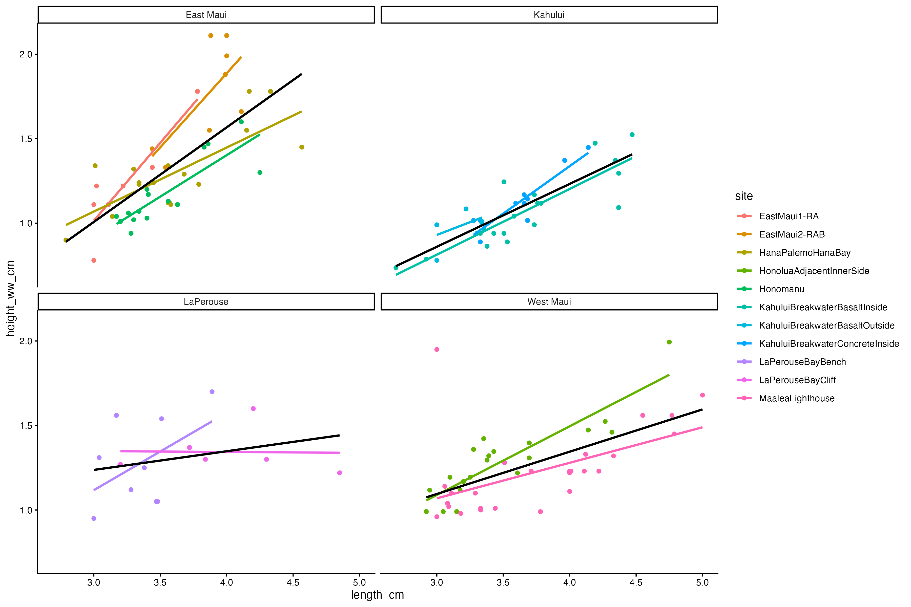
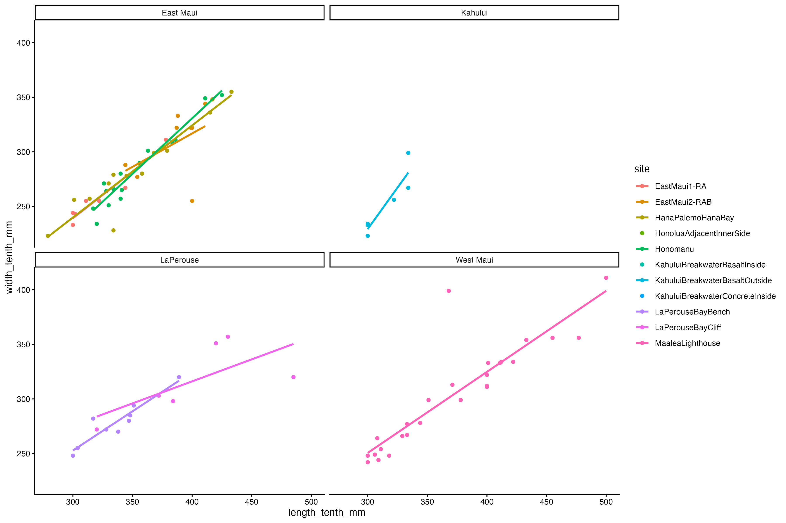

# Output Directory Documentation

This directory contains figures generated from the opihi morphology and microhabitat analysis scripts. The PNG files are derived outputs and should be reproducible from `../scripts/visualizeOpihiMicrohabitat.R` after sourcing `../scripts/readOpihiMicrohabitat.R`.

## Results Summary

These committed figures were generated from an earlier 123-observation, 10-site snapshot. The current primary CSV contains 144 observations across 11 site labels, including a new `KahuluiBreakwaterBasaltOutside` group and additional `MaaleaLighthouse` records. Regenerate the figures before using them as summaries of current data. Patterns described from the older snapshot must be reassessed after regeneration; PCA and thermal-dissipation figures remain exploratory.

The directory also contains `thermal_index_2017-2023_comparison.pdf`, which is not rendered below because this README catalogs PNG figures only.

## Hypothesis-Specific Results

- [Hypothesis 1: Does thermal refuge proximity affect shell shape?](refuge-proximity_shell-shape.md)
- [Hypothesis 2: Does phenotypic variation vary among sampling locations?](variation-with-location.md)
- [Hypothesis 3: Is habitable area correlated with shell shape?](habitable-area_shell-shape.md)

## Figure Catalog

### Figure 1. Raw Length Versus Raw Height

Scatterplot of shell height measured widest-way against shell length, colored by site, with linear smooths. The figure shows a positive relationship between length and height and highlights size differences among sampled sites.

### Figure 2. Raw Length Versus Raw Width

Scatterplot of shell length (in tenth of a mm) against shell width (in tenth of a mm), colored by site, with linear smooths. This figure is mainly used to spot outliers, which could be signs of erroneous measurements.

