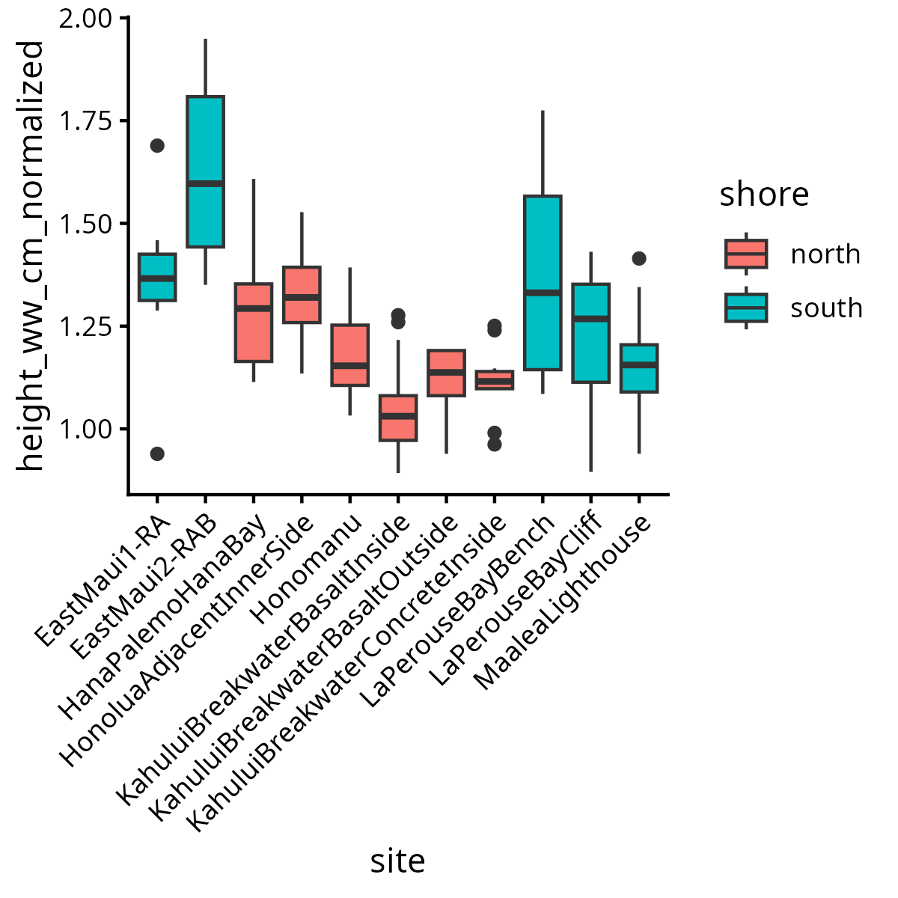
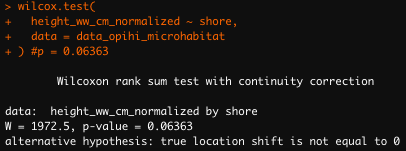
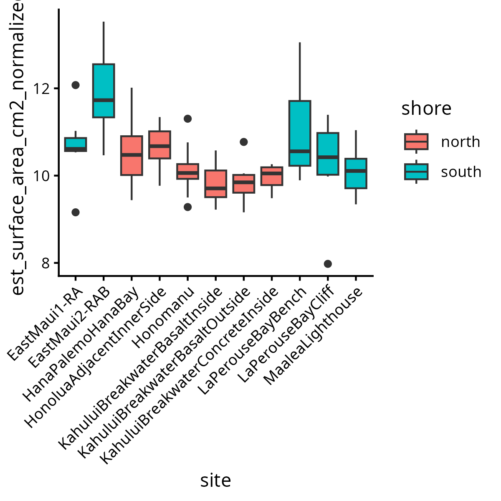
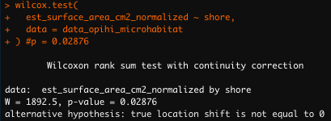
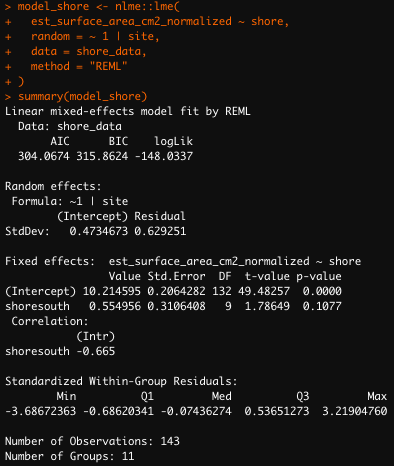
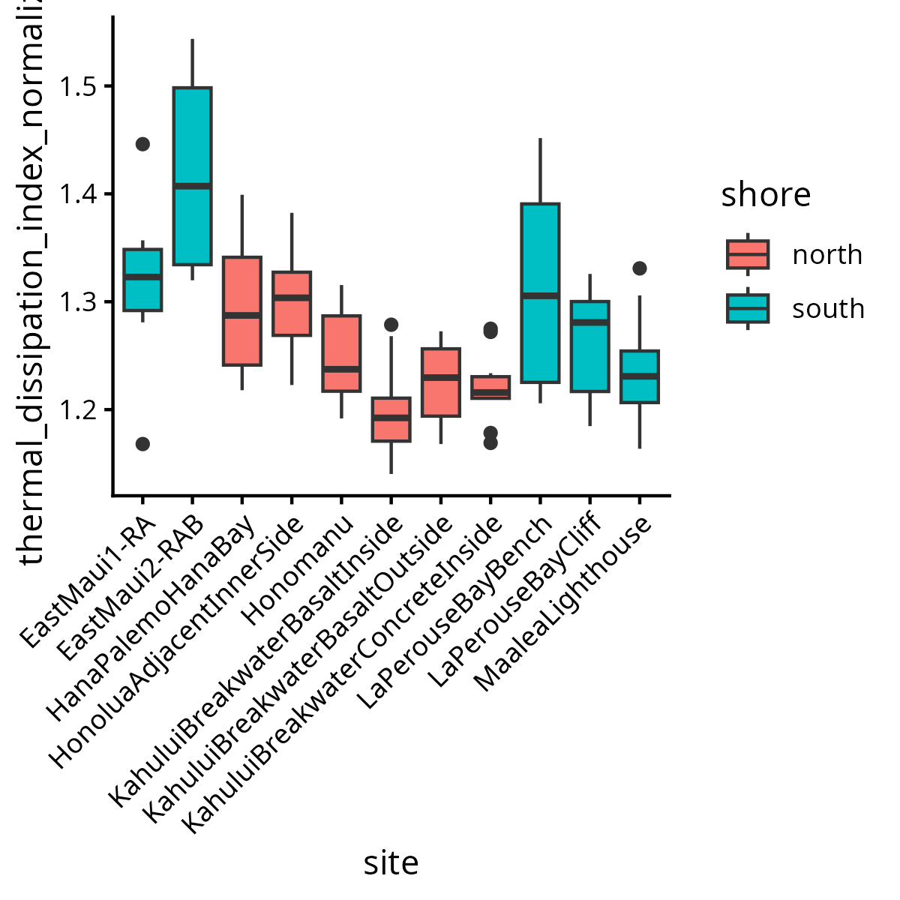
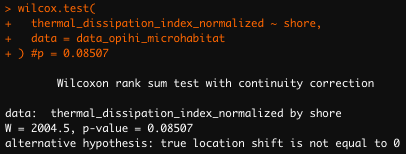
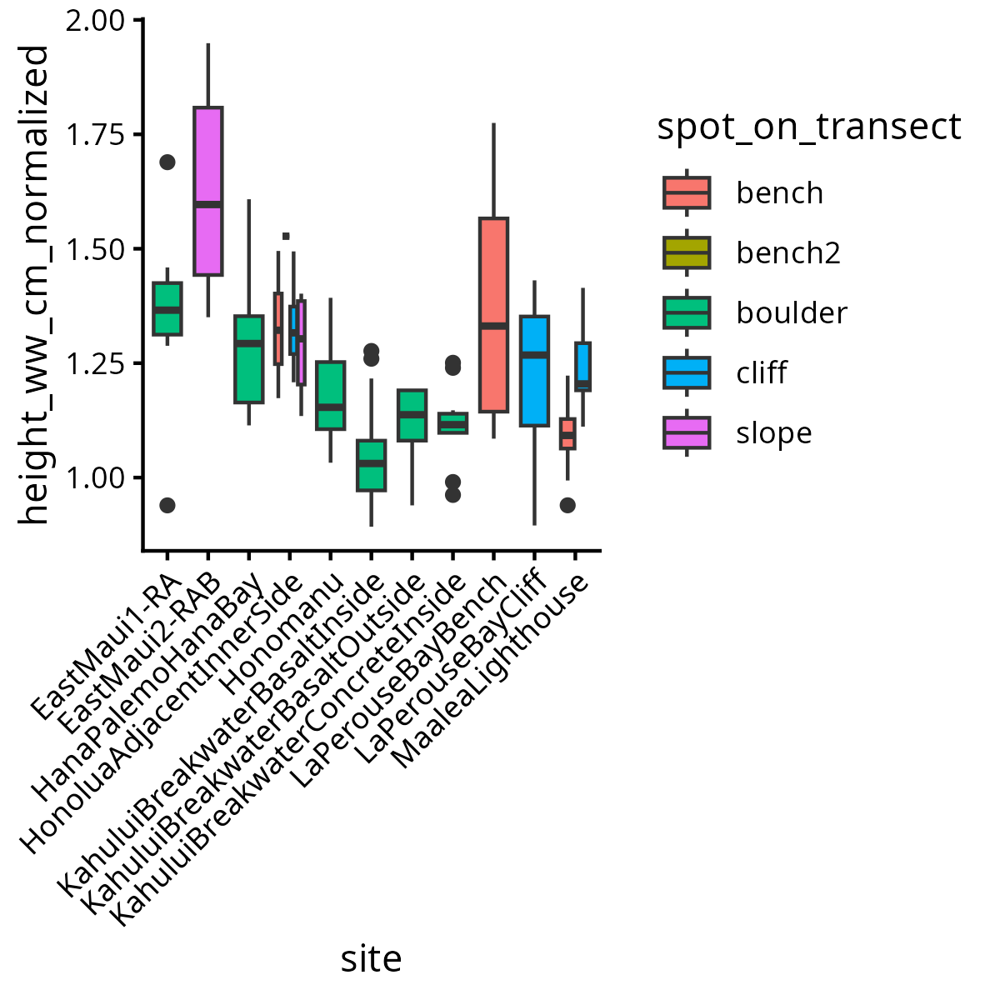
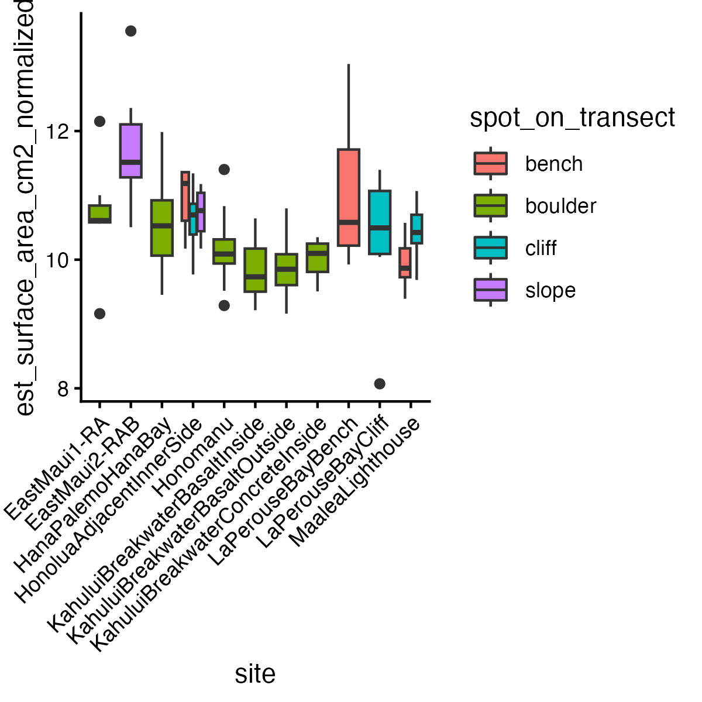
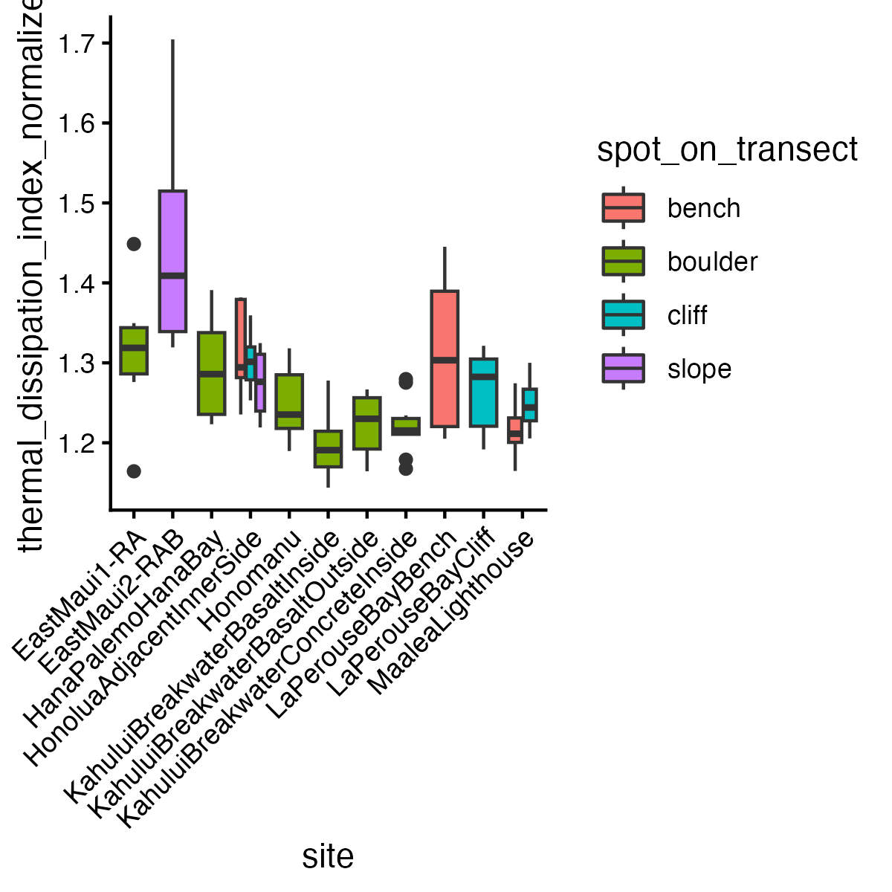

[← Back to Output Directory](README.md)

# Output Directory Documentation

This directory contains the output and results for hypothesis 3: is habitable area correlated with shell shape?

## Figure Catalog

### Figure 1. Normalized Height by North/South Shore

### Figure 2. Normalized Surface Area by North/South Shore

### Figure 3. Normalized Thermal Dissipation Index by North/South Shore

### Figure 4. Normalized Height by Shore Type

### Figure 5. Normalized Surface Area by Shore Type

### Figure 6. Normalized Thermal Dissipation Index by Shore Type

