[← Back to Output Directory](README.md)

# Output Documentation

This contains output related to hypothesis 1: does thermal refuge proximity affect shell shape?

## Figure Catalog

### Figure 1. Normalized Thermal Dissipation Index by Distance to Shelter

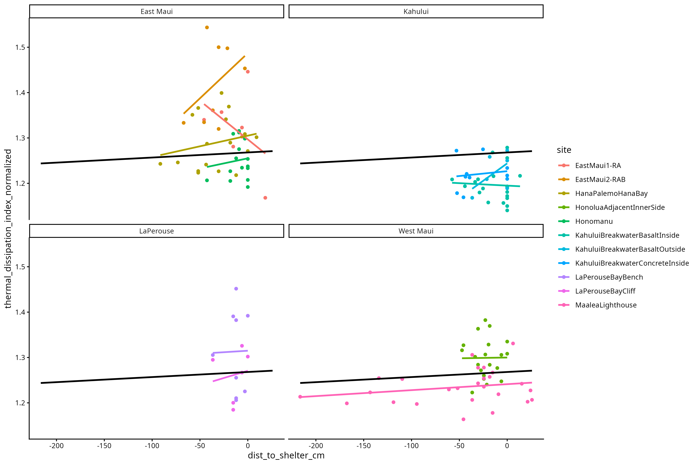

Scatterplot of normalized thermal dissipation index by distance to shelter with linear smooths. Positive slopes indicate increasing ability to dissipate heat as shelter proximity increases. Black line is overall best fit.

Tried to do an lme, model creation worked fine with no interaction between sites, couldn't reach a convergence when interaction was included, even after 1000 iterations.

Was able to do contrast tests though.

EastMaui1-RA vs HanaPalemoHanaBay

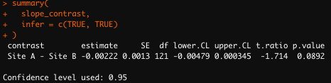

EastMaui1-RA vs EastMaui2-RAB

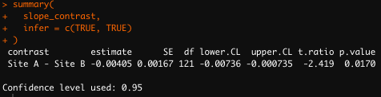

### Figure 2. Normalized Height Index by Distance to Shelter

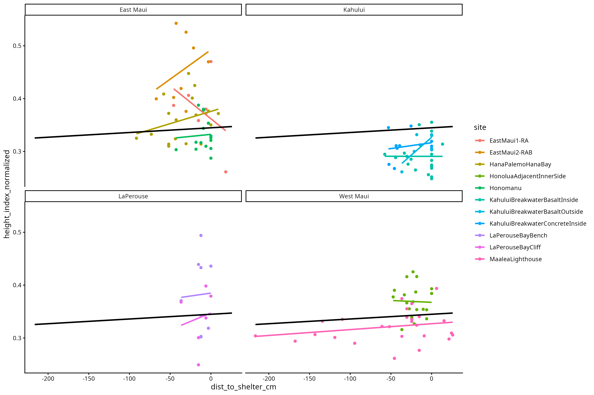

Scatterplot of normalized height index by distance to shelter, grouped by site, with linear smooths. Positive slopes indicate increasing shell height as shelter proximity increases.

EastMaui1-RA vs HanaPalemoHanaBay

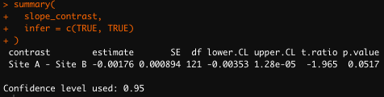

### Figure 3. Erosion by Distance to Shelter

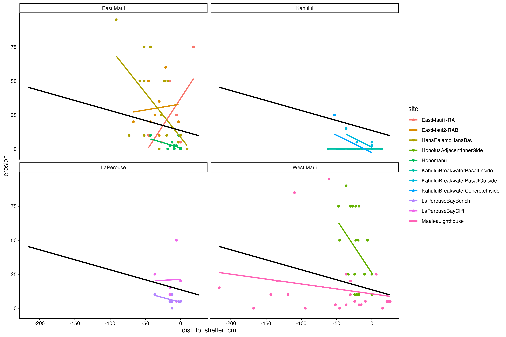

### Figure 4. Normalized Thermal Dissipation Index by Distance to Littoraria pintado

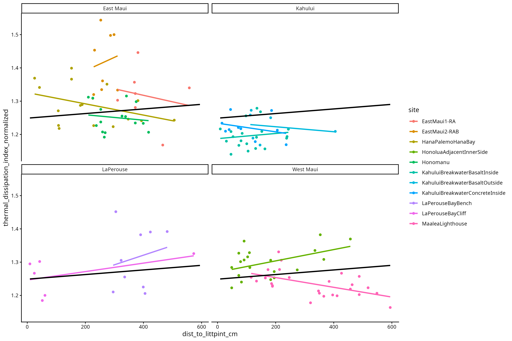

Linear models were made representing the relationship between thermal dissipation index and distance to the extremophile snail Littoraria pintado, one accounting for interactions between sites and one not accounting for such interactions. The ANOVA run was non significant. REPLACE THIS WITH A TABLE.

HanaPalemoHanaBay vs HonoluaAdjacentInnerSide

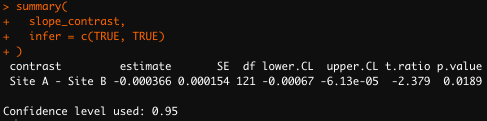

### Figure 5. Normalized Height Index by Distance to Littoraria pintado

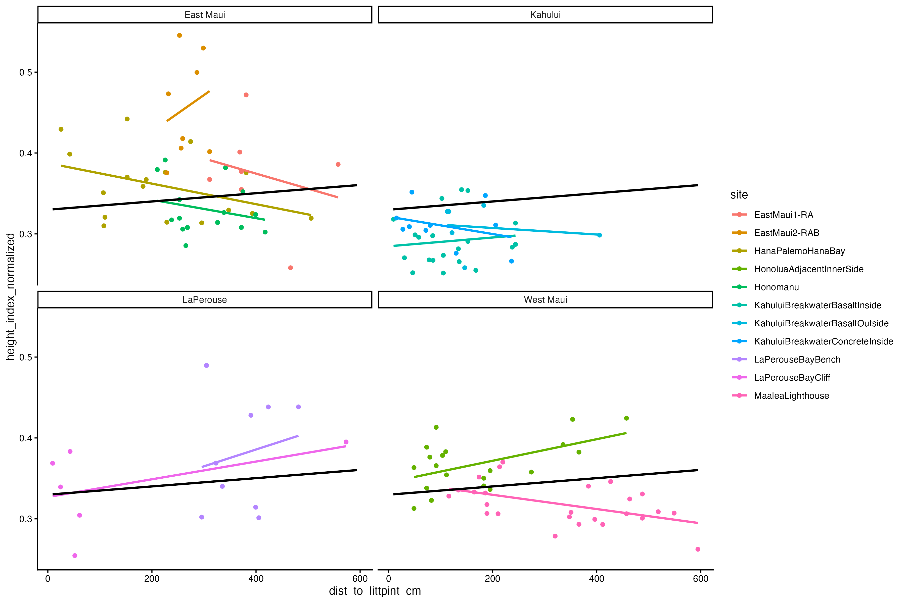

Linear models were made representing the relationship between height index and distance to the extremophile snail Littoraria pintado, one accounting for interactions between sites and one not accounting for such interactions. The ANOVA run was non significant. REPLACE THIS WITH A TABLE.

### Figure 6. Normalized Thermal Dissipation Index by Distance to Open Water

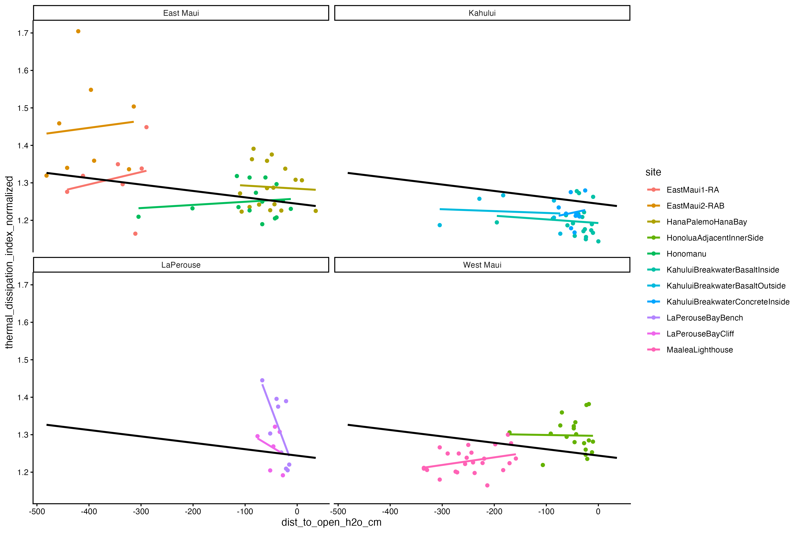

Scatterplot of normalized thermal dissipation index by distance to open water with linear smooths. Positive slopes indicate increasing thermal dissipation ability with increasing distance to open water.

EastMaui1-RA vs KahuluiBreakwaterBasaltInside

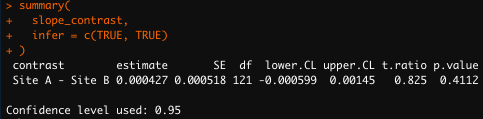

### Figure 7. Surface Area Deviation by Refuge Availability

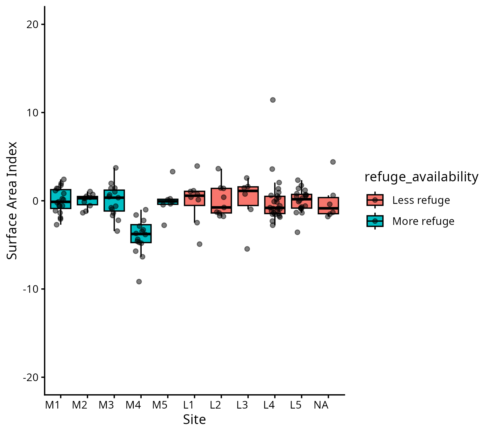

Site-level boxplots of deviation from mean normalized surface area, grouped by the script-defined refuge availability category. The figure suggests higher positive deviations in the “less refuge” group.

### Figure 8. Normalized Height Index by Percent Limu Shell Coverage

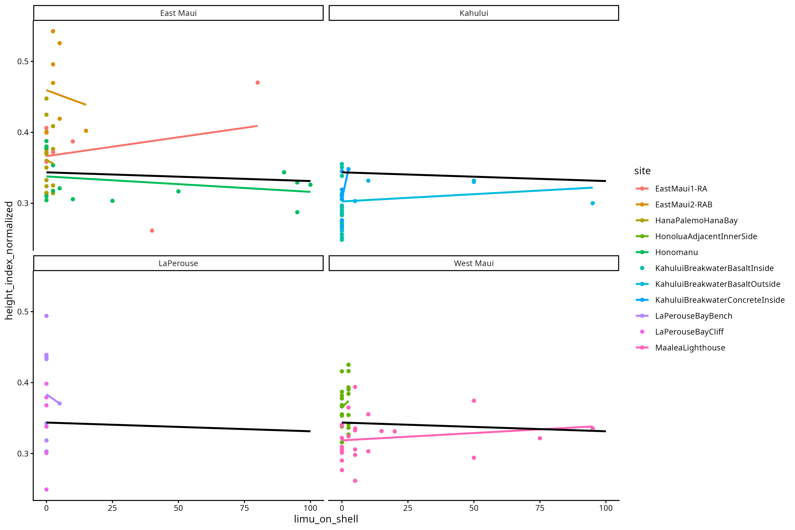

Scatterplot of normalized height index by percent limu shell coverage with linear smooths. Positive slopes indicate increasing shell height with increasing limu coverage.

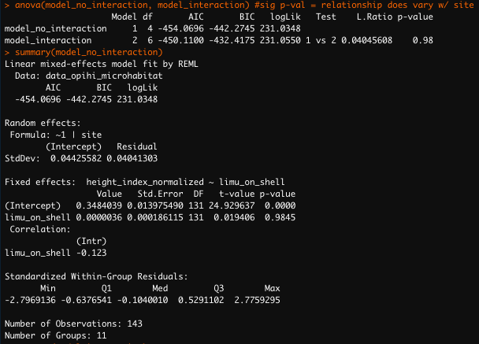

### Figure 9. Normalized Thermal Dissipation Index by Surface Angle

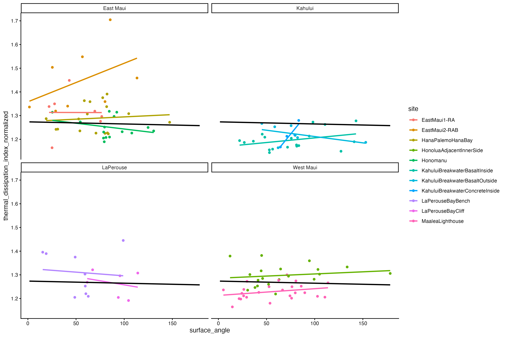

Scatterplot of normalized thermal dissipation index to surface angle with linear smooths. TABLE THIS OUT.

